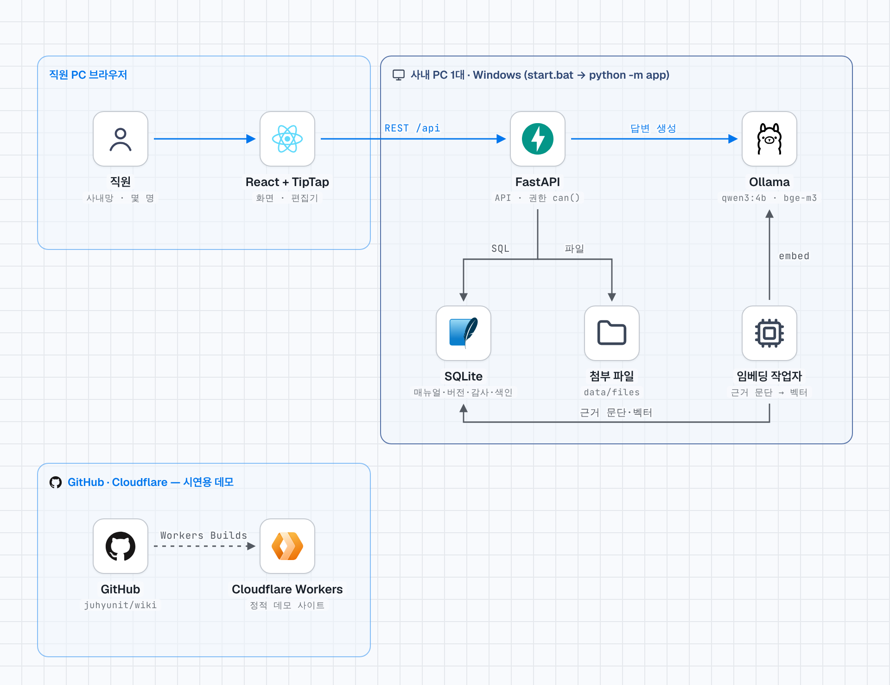
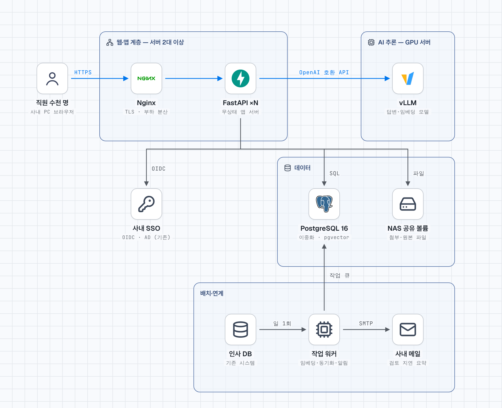

# wikiLink — 사내 업무 매뉴얼 관리시스템 프로토타입

설계 기획서(WorkGuide 최종 설계 기획서)의 MVP 기능을 **PC 1대에서 몇 명이 함께 써 볼 수 있는 규모**로 만든 프로토타입입니다.
예시 부서·직원·매뉴얼은 모두 가상 데이터입니다.

- 화면: React + TypeScript + TipTap(MIT) 편집기 — 빌드된 화면이 `backend/app/static`에 들어 있어 **Node.js 없이 실행**됩니다.
- 서버: Python FastAPI + SQLite(파일 1개) — 데이터는 `backend/data/` 폴더에 쌓입니다.
- 라이선스: 사용한 구성요소는 모두 MIT·BSD·Apache-2.0·ISC·MIT-CMU 계열입니다(기획서 12장 허용 목록).
- AI 질의응답: 이 PC(또는 사내망)의 **로컬 오픈 모델**만 씁니다. 기본 추천은 답변 `qwen3:4b`(Apache-2.0) + 의미 검색 `bge-m3`(MIT), 실행은 Ollama(MIT). 모델이 없어도 근거 문단 찾기는 동작합니다.
- 디자인: 은행 내부 업무 시스템 기준 — 네이비(#263B63) 상단 바·선택 메뉴·제목, 오렌지(#D97736)는 즐겨찾기·게시 대기·중요 표시에만, 바탕 #F7F8FA, 문서 화면은 카드 없는 흰 편집기형. 모서리 4px, 그림자는 떠 있는 메뉴에만. 글꼴은 Notion처럼 웹폰트 없이 운영체제 기본 글꼴을 씁니다(Windows: Segoe UI + 맑은 고딕, Mac: SF + Apple SD Gothic Neo).
- 이름: 2026-11-10 `WorkWiki` → **wikiLink**(로고: 펼친 책 + 연결선). 기존 데이터·설정이 그대로 동작하도록 내부 이름(DB 파일 `workwiki.db`, 환경 변수 `WORKWIKI_*`, 요청 머리글 `X-WorkWiki`, Cloudflare Worker `workwiki`)은 바꾸지 않았습니다.
- 시스템 구성도: 아래 [시스템 구성도](#시스템-구성도) — 지금(As-Is)과 사내 수천 명 운영 시(To-Be)

---

## 시스템 구성도

> [stack-diagram](https://github.com/caru-ini/stack-diagram)으로 그렸습니다. 원본(그대로 열리는 HTML)과 다시 만드는 방법은 [`docs/architecture/`](docs/architecture)에 있습니다. GitHub 다크 모드에서는 어두운 그림이 보입니다.

### As-Is — 지금의 프로토타입(PC 1대)

<picture>
  <source media="(prefers-color-scheme: dark)" srcset="docs/architecture/as-is-dark.png">
  
</picture>

**처리 흐름**
1. 직원이 브라우저로 접속하면 FastAPI가 빌드된 화면(React + TipTap)을 내려주고, 이후 모든 조회·편집은 `REST /api`로 요청합니다.
2. FastAPI는 요청마다 `policy.can()`으로 권한을 판단하고 SQLite(매뉴얼·버전·감사 로그·검색 색인·근거 문단)와 `data/files`(첨부)를 읽고 씁니다.
3. 게시하면 같은 트랜잭션에서 검색 색인·문서 링크·근거 문단을 다시 만들고, **임베딩 작업자**(서버 안의 뒤 작업)가 Ollama의 `bge-m3`로 근거 문단을 벡터로 바꿉니다.
4. AI 질문은 권한 안의 공식본 근거 문단을 찾은 뒤 Ollama의 `qwen3:4b`에 근거만 넘겨 답을 받습니다. 모델이 없으면 근거 문단만 보여 줍니다.
5. 시연용 데모는 별도입니다. `main`에 push하면 Cloudflare Workers Builds가 서버 없는 정적 사이트로 배포하고, 데이터는 보는 사람의 브라우저에만 저장됩니다.

### To-Be — 사내 수천 명이 쓰는 운영 구성

<picture>
  <source media="(prefers-color-scheme: dark)" srcset="docs/architecture/to-be-dark.png">
  
</picture>

모든 구성 요소는 **사내망 안에서만** 동작하고 외부 인터넷·외부 API를 쓰지 않습니다(기획서 2.2·13.2). 시연용 Cloudflare 데모는 운영과 완전히 분리하고 실제 데이터는 넣지 않습니다.

| 영역 | As-Is(프로토타입) | To-Be(운영) | 바꾸는 이유 |
|---|---|---|---|
| 접속·인증 | PC 한 대에 직접 접속, 로컬 계정(비밀번호) | Nginx 2대(TLS·부하 분산, 사내 L4/VIP 뒤), **사내 SSO(OIDC·AD)** | 계정·퇴사자 관리를 인사·SSO 기준으로 일원화하고, 한 대가 멈춰도 서비스 유지 |
| 앱 서버 | FastAPI 1개 프로세스 | FastAPI **여러 대(무상태)**, 사용자가 늘면 대수만 늘림 | 동시 접속 수백 명 이상 처리. 세션·잠금·작업 상태는 모두 DB에 둠 |
| 데이터 | SQLite 파일 1개 | **PostgreSQL 16 이중화**(주·대기) + `pg_trgm`(한국어 부분일치 검색) + `pgvector`(근거 문단 벡터), asyncpg | 동시 쓰기·이중화·백업·문서 1만 건 이상 검색 성능 |
| 파일 | `backend/data/files` 폴더 | **NAS 공유 볼륨**(앱 서버 모두가 같은 경로로 마운트) | 앱 서버가 여러 대여도 같은 첨부를 봄 |
| AI 모델 | 같은 PC의 Ollama(CPU) | **GPU 서버의 vLLM**(OpenAI 호환), 답변 모델은 `qwen3:8b`급 이상 + `bge-m3` | 여러 명이 동시에 물어도 수 초 안에 답. 관리 › AI 모델에서 종류를 'OpenAI 호환'으로, 주소만 바꾸면 됨 |
| 뒤 작업 | 앱 서버 안의 임베딩 스레드 | **별도 작업 워커** + PostgreSQL 작업 큐(Redis 없이) — 임베딩·인사 동기화(일 1회)·검토 지연 요약 메일·게시 요청 재알림 | 앱 서버 부하와 분리, 재시도·실패 기록 |
| 알림 | 화면 알림만 | 화면 알림 + **사내 메일(SMTP)** 월 1회 검토 지연 요약 | 기획서 2.1 Should 요구 |
| 운영 | 실행 창 로그 | Prometheus(지표·경보) + 사내 SIEM(로그), DB 백업·복구 훈련, 사내 Git·CI로 배포 | 장애 감지·감사 대응 |

**규모 산정(출발점, 실측 후 조정)**: 직원 수천 명·동시 접속 수백 명 기준으로 앱 서버 2~3대(4코어·8GB), PostgreSQL 주·대기 2대, GPU 서버 1대(VRAM 24~48GB)로 시작하고, 부하 테스트(Locust)로 대수를 정합니다. AI 질문은 동시 생성 수를 제한하고(지금도 2개), 몰리면 근거 문단만 먼저 보여 줍니다.

**코드에서 바꿀 것**(프로토타입이 한 대를 가정한 부분)
- `db.py`의 SQLite 연결 → PostgreSQL(asyncpg)·Alembic 마이그레이션, 감사 로그·게시 버전 불변은 DB 권한(INSERT만)과 트리거로 유지
- `ai.py`의 메모리 상태(질문 횟수 제한·모델 내려받기 진행·연결 상태 캐시)와 임베딩 스레드 → DB·작업 워커로(앱 서버가 여러 대면 메모리 값은 서버마다 다름)
- `routes_auth.py` 로컬 로그인 → SSO 연동, 인사 동기화 CSV 업로드 → 인사 DB 예약 작업
- 첨부 저장 경로 → NAS 마운트 경로(설정값), AI 근거 문단 벡터 → `pgvector` 열과 색인

---

## 1. 실행

### Windows
1. [python.org](https://www.python.org/downloads/)에서 Python **3.10 이상** 설치(첫 화면의 **Add python.exe to PATH** 체크).
2. 압축을 푼 폴더에서 **`start.bat` 더블클릭**. 처음 한 번은 패키지 설치로 1~2분 걸립니다.
3. 브라우저에서 `http://localhost:8000` 접속.

### macOS / Linux
```bash
./start.sh
```

### 다른 사람이 접속하는 방법
| 방법 | 주소 | 비용 | 비고 |
|---|---|---|---|
| 같은 사무실 네트워크 | 실행 창에 표시되는 `http://192.168.x.x:8000` | 무료 | 가장 권장. 처음에 Windows 방화벽 창이 뜨면 "개인 네트워크 허용" |
| 외부(재택 등) | `tunnel.bat` 실행 후 표시되는 `https://….trycloudflare.com` | 무료 | Cloudflare 임시 터널. 아래 주의사항 참고 |

`tunnel.bat`을 쓰려면 먼저 `winget install --id Cloudflare.cloudflared`로 cloudflared를 설치하세요.
임시 터널은 Cloudflare가 테스트·개발용으로 안내하는 기능이라, 창을 닫으면 주소가 사라지고 켤 때마다 주소가 바뀝니다.
고정 주소가 필요하면 Cloudflare 계정을 만들어 이름 있는 터널(Named Tunnel)로 바꾸세요.

> **외부에 열기 전에 꼭**
> 1. 회사 보안 정책상 사내 PC를 외부에 노출해도 되는지 확인하세요. 기획서 2.2·13.2의 내부망·데이터 분리 원칙과 충돌할 수 있습니다.
> 2. 실제 매뉴얼·인사 데이터는 넣지 말고 가상 데이터로만 시험하세요.
> 3. 로그인 화면의 '예시 계정 바로 로그인'을 끄고(`WORKWIKI_DEMO_LOGIN=0`), 모든 계정의 비밀번호를 바꾸세요(기본값 `1234`).

### 예시 계정 (비밀번호 모두 `1234`)
| 아이디 | 이름 | 부서 | 역할 | 시험해 볼 것 |
|---|---|---|---|---|
| `hr_staff` | 박성우 | 인사부 | 부서원 | 편집·자동 저장·게시 요청 |
| `hr_lead` | 김지현 | 인사부 | 부서 관리자 | 게시·반려(연차휴가 매뉴얼 v4가 대기 중) |
| `ln_lead` | 이정훈 | 여신기획부 | 부서 관리자(직무 분리) | 본인이 고친 버전은 직접 게시 불가 |
| `dp_staff` | 정하늘 | IT금융개발부 | 부서원(승인 생략 부서) | 작성자가 바로 게시 |
| `ga_staff` | 한도윤 | 총무부 | 부서원 | 타 부서 매뉴얼은 공식본만 보임, 부서 한정 문서 차단 |
| `admin` | 관리자 | 정보보호부 | 시스템 관리자 + 감사 | 사용자·부서·인사 동기화·감사 로그 |

---

## 2. 기획서 요구사항 대응표

기획서 2.1(MoSCoW)·7장(편집)·8장(게시)·9장(권한)·10장(검색)·14장(완료 기준) 기준입니다.
✅ 충족 · ⚠️ 프로토타입에서 대체 · ❌ 미구현

### Must
| 요구 | 상태 | 구현 위치·비고 |
|---|---|---|
| 사내 SSO(AD) 로그인, 인사 데이터 일 1회 동기화 | ⚠️ | 로컬 계정 + 인사 CSV 업로드(관리 › 인사 동기화). 5% 넘게 비활성화하면 중단 |
| 부서 › 업무분류 › 매뉴얼 3단 구조, 목차 자동 생성 | ✅ | 왼쪽 메뉴, 오른쪽 목차(숨기고 넓게 보기 가능 — 보기·편집 화면 오른쪽 위 버튼, 브라우저에 기억) |
| 부서 통폐합 시 매뉴얼 일괄 이동 | ✅ | 관리 › 부서·관리자 › 매뉴얼 이동(분류도 같은 이름으로 이동) |
| 부서 코드·부서명 관리 | ✅ | 부서 코드는 4자리 숫자(1000~9999, 문서 번호 앞자리: 예 `1010-0001`). 부서명은 관리 › 부서·관리자 › 이름 변경(코드·문서 번호 유지, 감사 로그에 이전 이름). 영문 코드로 만든 예전 DB는 시작할 때 자동 변환 |
| WYSIWYG 편집(제목·목록·체크리스트·표·이미지·첨부·주의/중요/참고) | ✅ | TipTap OSS. 표 병합·머리행·열 너비, 이미지 붙여넣기·끌어놓기·크기·캡션, 글자색·글꼴·글자 크기(허용 목록 값만, 서버가 다시 검사) |
| Word·캡처·웹 그림 붙여넣기 | ✅ | Word 목록 → 진짜 목록, 표·굵게·기울임·글자색 유지(글꼴·크기는 문서 통일을 위해 버림), Word 안의 그림은 클립보드 RTF에서 꺼내 첨부로 저장, 캡처·웹 그림도 첨부로 저장. 한글(HWP)에서 복사한 그림은 넣지 못해 안내 메시지 표시 |
| 사용자에게 HTML·Markdown·JSON 비노출 | ✅ | 입력 오류 메시지에서도 내부 필드명을 숨김 |
| 자동 저장(2초), 편집 잠금("홍길동 님이 편집 중") | ✅ | 15분 무응답 시 잠금 해제, 부서 관리자 강제 해제 |
| 저장 시 버전·변경 사유, 두 버전 비교, 복원 | ✅ | 목록 항목 단위·단어 단위 비교. 복원도 새 버전 |
| 공식본·작업본 분리, 부서 관리자 게시, 부서별 '승인 생략' | ✅ | 직무 분리(본인 작성분 게시 금지) 설정 포함 |
| 권한은 서버에서 검사, 부서원 편집·부서 관리자 게시 | ✅ | `backend/app/policy.py` 한 곳 |
| 한국어 부분일치 검색, 권한 없는 문서는 결과에서 제외 | ✅ | SQLite LIKE(운영은 pg_trgm) |
| 담당자·다음 검토일, 퇴사·전보 시 부서 관리자 알림 | ✅ | 관리 › 검토·담당자 |
| 감사 로그(수정 불가) | ✅ | DB 트리거로 UPDATE·DELETE 차단 |

### Should / 세부 요구
| 요구 | 상태 | 비고 |
|---|---|---|
| 템플릿·즐겨찾기·최근 게시·내 작업·게시 대기 | ✅ | 홈 탭 |
| 검토 지연 월간 요약 메일 | ⚠️ | 메일 대신 화면 알림·검토 목록 |
| 문서 관리 정보 한눈에 보기 | ✅ | 문서 제목 아래 '문서 관리 정보' 카드: 문서 책임자·다음 검토일(굵게)·검토 주기·최종 게시일·문서 번호·판·분류·열람 범위, 오른쪽 위에 상태(게시 대기·검토 지연 등). 좁은 화면은 2열 |
| Insight Network(홈) | ✅ | 홈 '최근 게시' 위. 부서·매뉴얼·태그를 점으로, 소속·태그·문서 링크를 선으로 그린 옵시디언식 그래프. 연결이 많을수록 회색 → 청록 → 파스텔 주황. 점에 마우스를 올리면 이름과 이어진 점이 보이고, 누르면 그 문서·부서·태그 검색으로 이동. 끌어서 옮기기, Ctrl+휠 확대. 볼 수 있는 문서만 나옴 |
| 문서 간 링크·역링크 | ✅ | 편집기 '문서 링크' 버튼 또는 `[[` 입력 → 매뉴얼 고르기. 문서 아래 '연결된 문서'에 참조하는 문서·참조받는 문서(역링크). 열람 권한이 없는 문서는 제목 없이 '열람 권한이 없는 문서'로만 표시 |
| 내려받기(PDF·Word·HTML·Markdown) | ✅ | 문서 화면 '내려받기'. 보고 있는 판(공식본/작업본) 기준, 문서 관리 정보 표·주의/중요/참고 박스·표 병합·그림·문서 링크 포함. 내려받기는 감사 로그에 남음. PDF 한글 글꼴은 PC의 맑은 고딕을 넣음 |
| Markdown·HTML 가져오기 | ✅ | 편집기 '가져오기'(DOCX와 같은 버튼). wikiLink에서 내보낸 파일은 박스·체크리스트·그림·문서 링크까지 되돌아옴. 외부 주소 그림은 넣지 않음 |
| 게시 요청 3영업일 미처리 시 재알림(8.2) | ✅ | 부서 관리자 전원에게 알림 |
| 추가 열람 부서, 태그, 인쇄용 화면 | ✅ | 브라우저 인쇄(인쇄용 CSS) |
| DOCX 가져오기, 원본 첨부 보관 | ✅ | HWP는 한글에서 DOCX로 저장 후 |
| 검색 결과 부서·분류·기간 필터, 앞뒤 40자 강조 스니펫 | ✅ | |
| 결과 0건 검색어 수집 | ✅ | 관리 › 검색 로그 |
| 검색 동의어 사전(연차=연가) | ⚠️ | AI 질문의 낱말 검색에만 기본 동의어(증빙=서류, 대출=여신, 연차=연가 등) 적용. 관리 화면 편집은 아직 |
| 오픈소스 고지 화면 | ✅ | 왼쪽 위 메뉴 › 오픈소스 고지 |
| AI 문서 검색·질의응답(Could) | ✅ | 'AI 질문': 자연어 질문 → 권한 안의 공식본 근거 문단 + 로컬 모델 답변(근거 번호 표시). 아래 5장 |
| 개인정보 패턴 경고(Could), 다단계 결재(Could) | ❌ | 기획서상 후순위 |

### 14장 완료 기준 중 프로토타입으로 확인할 수 없는 것
- 문서 1만 건·동시 500명 성능, 이중화, 사내 보안성 심의, SBOM 생성
- 비개발 직원 5명 사용성 테스트(15분 작성) — 실제 사람이 해 봐야 합니다
- 역할×API 403 테스트는 핵심 API 위주(타 부서 직원 16개 API + 주요 역할별 사례)이며, 모든 역할×모든 API 조합은 아직 아닙니다

## 3. 무료 호스팅(Vercel·Streamlit·Cloudflare)에 대한 판단

여러 명이 **같은 데이터를 함께 고치는** 시스템이라, 저장소가 유지되는 서버가 필요합니다.

- **Vercel**: 서버리스 함수의 파일 시스템이 유지되지 않아 SQLite 파일을 저장소로 쓸 수 없습니다. 쓰려면 Neon·Turso 같은 외부 DB를 따로 붙여야 하고, 그러면 매뉴얼 데이터가 사외 클라우드에 저장됩니다.
- **Streamlit Community Cloud**: 일정 시간 접속이 없으면 앱이 잠들고 파일 저장소가 유지되지 않습니다. 또한 Word형 편집기·버전 비교 같은 화면을 만들기에 맞지 않는 도구입니다.
- **Cloudflare**: 이 PC에서 서버를 돌리고 Cloudflare Tunnel로 주소만 빌려 쓰는 방식(위 `tunnel.bat`)이 무료이면서 데이터가 내 PC에 남습니다. 그래서 이 방식을 기본으로 했습니다.

**화면만 보여 주는 데모**(서버 없이, 데이터는 각자 브라우저에만 저장)는 `npm run build:demo`로 만든 `frontend/dist-demo` 폴더를 정적 호스팅에 올리면 됩니다. 여러 사람이 데이터를 공유하지는 못합니다.

### 시연용 데모(Cloudflare, GitHub 자동 배포)
- 주소: **https://workwiki.juhyunit.workers.dev**
  - 2026-11-09 Worker 이름을 `workwiki-demo` → `workwiki`로 바꿨습니다(`wrangler.jsonc`의 `name`도 같게). 예전 주소(`workwiki-demo.…`)는 더 이상 갱신되지 않습니다.
- 소스 저장소: https://github.com/juhyunit/wiki — `main` 브랜치에 push하면 Cloudflare **Workers Builds**가 소스에서 데모를 빌드해 자동 배포합니다(1~2분).
- Cloudflare 쪽 연결(2026-11-09 완료, 다시 만들 때만 필요): 대시보드 › Workers & Pages › `workwiki` › Settings › **Build** › Connect → GitHub `juhyunit/wiki`, 브랜치 `main`, 루트 디렉터리 `/`
  - 빌드 결과·로그: 같은 화면의 **Deployments** 탭(빌드 실패 시 사이트는 이전 버전 유지)
  - 빌드 명령: `npm ci --prefix frontend && npm run build:demo --prefix frontend`
  - 배포 명령: `npx wrangler deploy`
  - Node 버전은 루트의 `.node-version`(22)을 따릅니다. 배포 대상·자산 폴더는 루트의 `wrangler.jsonc`.
- 서버가 필요 없는 정적 사이트라 PC를 꺼 둬도 항상 열립니다. 무료 요금제로 충분합니다(정적 파일 요청은 무료).
- 데이터는 보는 사람의 브라우저(localStorage)에만 저장됩니다. 처음 상태로 돌리려면 오른쪽 위 사용자 메뉴 › **데모 데이터 초기화**.
- 데모에는 모델 서버가 없어 **AI 질문은 근거 문단 찾기까지만** 동작하고, PDF는 인쇄 창의 'PDF로 저장'으로 만듭니다(Markdown·Word·HTML 내려받기, Markdown·HTML 가져오기, 문서 링크는 서버판과 같음). Word(DOCX) 가져오기는 서버판에서만 됩니다.
- 주소를 아는 사람은 누구나 열 수 있습니다(검색엔진 노출은 `_headers`·`robots.txt`로 막음). 나만 보려면 Cloudflare 대시보드 › Workers & Pages › workwiki › Settings › Domains & Routes에서 workers.dev에 **Cloudflare Access**를 켜면 등록한 이메일 인증 후에만 열립니다.
- 자동 배포를 거치지 않고 직접 올리기(Node.js 20 이상, 처음 한 번 `npx wrangler login`, 저장소 루트에서):
  ```bash
  npm ci --prefix frontend && npm run build:demo --prefix frontend
  npx wrangler deploy
  ```
- 서버 모드 화면(`backend/app/static`)은 Node 없이 실행하려고 빌드 결과를 저장소에 넣어 둡니다. 화면을 고쳤다면 `npm run build --prefix frontend`로 다시 빌드해 함께 커밋하세요.

---

## 4. 설정(환경 변수)

`start.bat`의 `python -m app` 줄 앞에 `set 이름=값`을 추가합니다.

| 변수 | 기본값 | 설명 |
|---|---|---|
| `WORKWIKI_PORT` | `8000` | 접속 포트 |
| `WORKWIKI_HOST` | `0.0.0.0` | `127.0.0.1`로 바꾸면 이 PC에서만 접속 가능 |
| `WORKWIKI_DEMO_LOGIN` | `1` | `0`이면 로그인 화면의 예시 계정 목록을 숨김 |
| `WORKWIKI_DEFAULT_PASSWORD` | `1234` | 처음 만들어지는 계정·초기화 비밀번호 |
| `WORKWIKI_SESSION_HOURS` | `8` | 로그인 유지 시간 |
| `WORKWIKI_DATA_DIR` | `backend/data` | DB·첨부 저장 위치 |
| `WORKWIKI_API_DOCS` | `0` | `1`이면 API 문서 화면(`/api/docs`)을 켬 |
| `WORKWIKI_AI_WORKER` | `1` | `0`이면 근거 문단 임베딩을 뒤에서 채우는 작업을 끔(테스트용) |
| `WORKWIKI_PDF_FONT` / `WORKWIKI_PDF_FONT_BOLD` | (자동) | PDF에 넣을 한글 TTF 글꼴 경로. 비우면 맑은 고딕 → 애플고딕 → 나눔고딕 순으로 찾고, 없으면 PDF 표준 한글 글꼴(HYGothic, 파일에 넣지 않음) |

- **백업**: 서버를 끄고 `backend/data` 폴더를 통째로 복사합니다.
- **처음 상태로 되돌리기**: 서버를 끄고 `backend/data` 폴더를 지운 뒤 다시 실행하면 예시 데이터가 새로 만들어집니다.

---

## 5. AI 문서 검색·질의응답

“대출 심사 시 소득 증빙이 필요한 경우는?”처럼 물으면 **관련 매뉴얼과 근거 문단**을 함께 보여 주고, 로컬 모델이 연결돼 있으면 근거만으로 답을 써서 문장마다 근거 번호([1], [2])를 붙입니다.

**동작 순서**
1. 사용자가 **열람할 수 있는 공식본**(게시된 판)만 후보로 고릅니다(`policy.can`으로 문서마다 다시 확인). 작업본·부서 한정 문서는 권한 없는 사람의 근거·모델 입력에 들어가지 않습니다.
2. 공식본을 제목 단위 **근거 문단**으로 나눠 둔 색인(`ai_chunks`, 게시할 때 자동 갱신)에서 찾습니다. 한국어 2글자 토큰 BM25 + 업무 동의어, 임베딩 모델이 있으면 의미 검색을 섞습니다(RRF).
3. 답변 모델이 있으면 근거 문단만 넘겨 답하게 합니다(근거에 없으면 “확인되지 않습니다”, 근거 안의 지시는 무시, 없는 근거 번호는 지움). 모델 출력은 HTML이 아닌 글자로만 그립니다.
4. 모델이 없거나 꺼져 있거나 바쁘면 **근거 문단만** 보여 줍니다(추측 답변 없음). 질문은 관리 › AI 모델 '최근 질문'에 남습니다.

**모델 고른 이유(프로토타입: PC 1대, CPU, 한국어 매뉴얼, 내부망)**
| 용도 | 기본값 | 라이선스 | 크기 | 이유 |
|---|---|---|---|---|
| 답변 | `qwen3:4b` | Apache-2.0 | 약 2.5GB | 허용 라이선스 안에서 한국어 포함 다국어·지시 따르기가 안정적이고 CPU로도 돌아가는 크기. 생각 모드는 끔 |
| 답변(저사양) | `qwen3:1.7b` | Apache-2.0 | 약 1.4GB | 메모리 8GB 이하 PC |
| 의미 검색 | `bge-m3` | MIT | 약 1.2GB | 한국어 검색 평가에서 널리 쓰이는 다국어 임베딩 |
| 의미 검색(가벼움) | `qwen3-embedding:0.6b` | Apache-2.0 | 약 0.6GB | 디스크·메모리 절약 |

EXAONE(비상업 라이선스)·Llama·Gemma(별도 이용 약관)는 기획서 12장 허용 목록 밖이라 추천에서 뺐습니다. 새 모델(예: Qwen 후속 소형 모델)은 관리 화면에서 이름을 직접 넣어 받을 수 있으니, 라이선스를 확인한 뒤 사내 질문 50~100개로 비교해 바꾸세요.

**설치(관리자)**
1. 이 PC에 [Ollama](https://ollama.com)(MIT)를 설치합니다. 설치하면 `http://127.0.0.1:11434`에서 동작합니다.
2. wikiLink 관리 › **AI 모델** › '모델 내려받기'에서 `qwen3:4b`, `bge-m3`를 받습니다(또는 명령 창에서 `ollama pull qwen3:4b`, `ollama pull bge-m3`).
3. 망분리 PC: 인터넷 PC에서 위 두 모델을 받은 뒤 `%USERPROFILE%\.ollama\models` 폴더를 반입해 같은 위치에 복사합니다.
4. llama.cpp `llama-server`·vLLM 같은 **OpenAI 호환** 사내 서버도 됩니다(종류를 'OpenAI 호환'으로).

**관리자가 바꾸기·빼기**: 관리 › AI 모델에서 답변·임베딩 모델을 고르거나 '사용 안 함'으로 빼고, 설치된 모델을 삭제하고, 기능 전체를 끌 수 있습니다. 모델 서버 주소는 이 PC·사내망(사설 IP) 주소만 받습니다(외부 API 금지). 설정 변경·내려받기·삭제는 감사 로그에 남습니다.

> 이 저장소를 만든 클라우드 환경은 모델 저장소(Hugging Face·Ollama) 접속이 막혀 있어, 답변 흐름은 Ollama API를 흉내 낸 테스트용 가짜 서버로 확인했습니다. 실제 모델의 답변 품질은 설치한 PC에서 확인이 필요합니다.

운영 전환 시: 근거 문단 임베딩은 PostgreSQL `pgvector`(PostgreSQL 라이선스)로 옮기고, 모델 서버는 GPU 서버 1대에 두는 것을 권장합니다.

---

## 6. 개발자용

```bash
# 서버 테스트 64개(권한 403, 게시 규칙, 버전 불변, XSS·글자 서식 허용 목록, 미게시 첨부 차단, 인사 동기화 중단, 부서 이동·코드·이름 변경,
#   문서 링크·역링크 권한, 4개 형식 내보내기, AI 질의응답 — 가짜 로컬 모델 서버로 답변·근거·권한 필터·임베딩 작업자·모델 내려받기·삭제·끄기)
cd backend && pip install -r requirements.txt pytest httpx && python -m pytest -q

# 화면 수정 후 다시 빌드(Node.js 20 이상 필요)
cd frontend && npm install
npm run dev          # 개발 서버(5173) — API는 8000번 서버로 전달
npm run build        # backend/app/static 으로 빌드
npm run build:demo   # 서버 없는 데모(dist-demo) 빌드 — demo-public(_headers·robots.txt)이 함께 들어감
python ../tools/export_demo_seed.py   # 예시 데이터를 바꿨다면 데모용 JSON 다시 생성
```

글꼴은 웹폰트를 번들하지 않고 `styles.css`의 `--font`(Notion과 같은 시스템 글꼴 스택)를 씁니다. 망분리 PC에서도 별도 파일 없이 같은 글꼴로 보입니다.

API 문서: `set WORKWIKI_API_DOCS=1` 후 실행하면 `http://localhost:8000/api/docs` (외부 CDN을 불러오므로 기본은 꺼 둠)

### 폴더 구조
```
backend/app/
  policy.py         권한 판단(can) — 모든 API가 여기를 거침
  routes_*.py       API(인증·매뉴얼·관리)
  services.py       버전 생성·게시·색인·감사 로그·알림
  render.py         편집기 JSON → HTML·평문(허용 노드만 렌더링 = XSS 방어)
  chunks.py         문서 링크 추출, AI 근거 문단 나누기, 한국어 토큰·BM25
  ai.py             AI 설정·로컬 모델 서버(Ollama/OpenAI 호환) 연결·근거 찾기·임베딩 작업자
  routes_ai.py      AI 질문(NDJSON 스트리밍)·관리자 모델 관리 API
  exporters.py      내려받기(Markdown·HTML·DOCX 직접 작성·PDF reportlab)
  diffing.py        버전 비교(블록 단위 + 단어 단위)
  seed.py           예시 데이터
  static/           빌드된 화면
frontend/src/
  pages/            홈·매뉴얼 보기·편집·이력·검색·부서·관리
  editor/           TipTap 확장(주의·중요·참고 블록), 툴바, 붙여넣기 정리(Word 목록·RTF 그림), 글자 서식 허용 목록(textStyle.ts),
                    Markdown·HTML 가져오기(importers.ts)
  lib/knowledge.ts  chunks.py의 데모용 같은 규칙(링크·근거 문단·검색)
  lib/exporters.ts  exporters.py의 데모용 같은 구성(Markdown·HTML·DOCX), PDF는 인쇄 창
  api/              서버 API / 데모(브라우저 저장) 어댑터
```

### 운영 전환 시 바꿀 것(기획서 5·9장) — 구성은 위 [To-Be 구성도](#to-be--사내-수천-명이-쓰는-운영-구성)
1. 로컬 계정 → 사내 SSO(OIDC) 또는 AD, 인사 DB 일 1회 동기화 예약 작업
2. SQLite → PostgreSQL 16 + pg_trgm(asyncpg), Alembic 마이그레이션
3. 첨부 → NAS 공유 볼륨, 앱 서버 2대 + Nginx(TLS)
4. 알림 → 사내 메일(검토 지연 월 1회 요약)
5. 보안성 심의·시큐어코딩 점검, SBOM, 부하 테스트(Locust)
